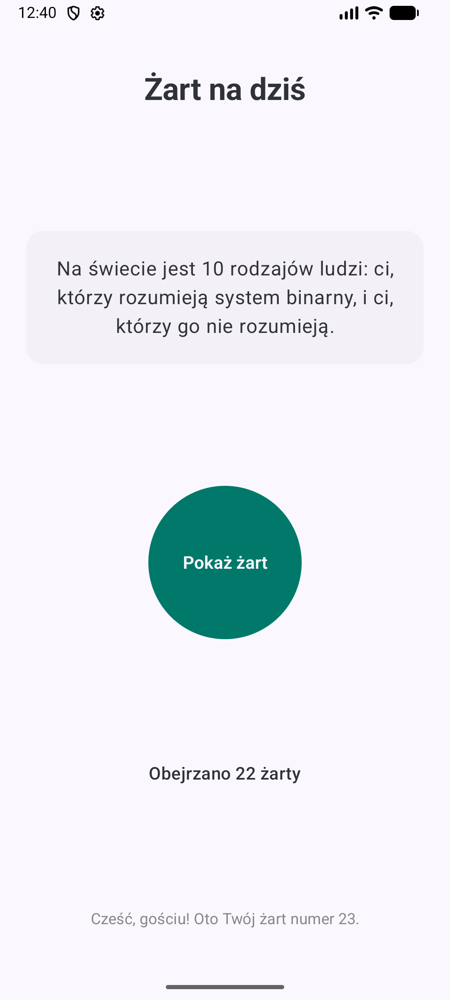
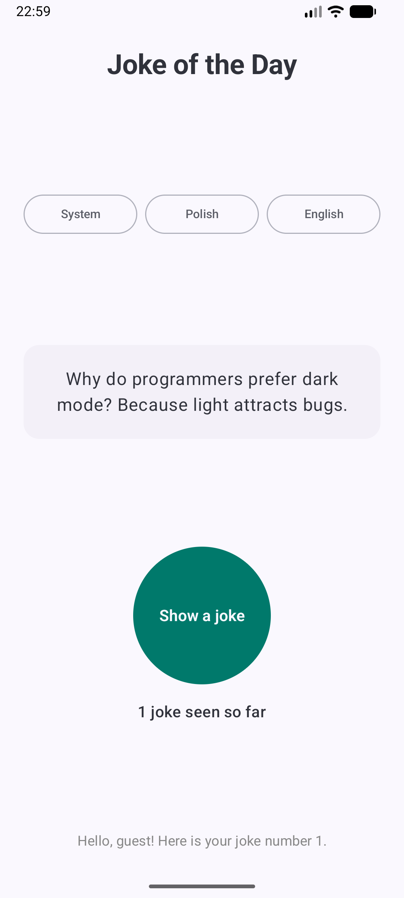
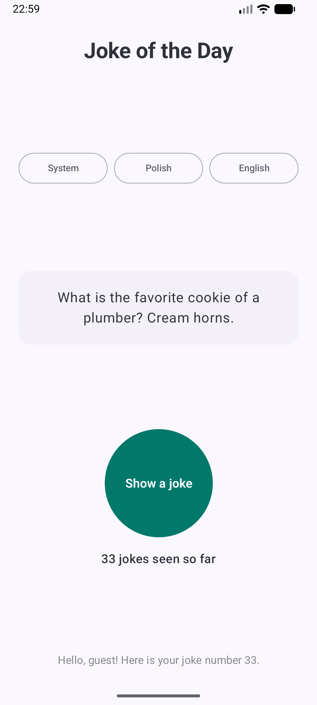
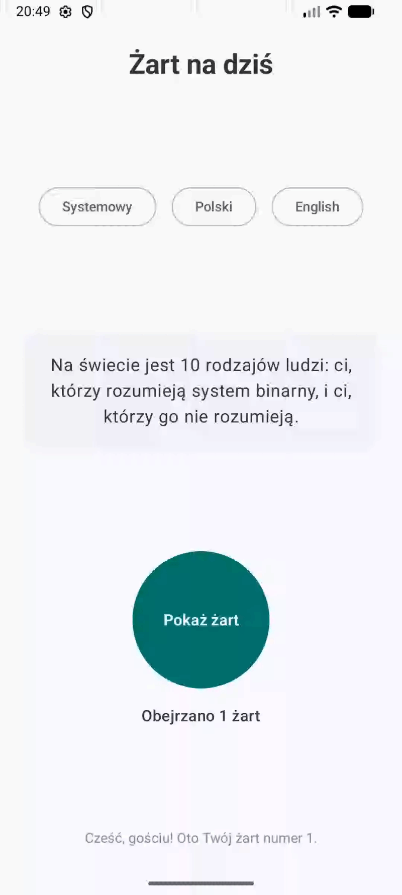
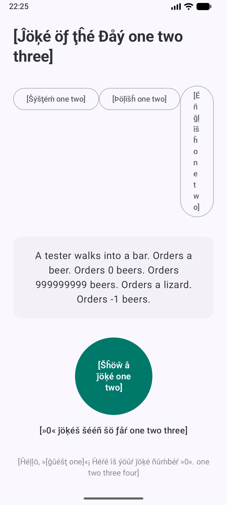
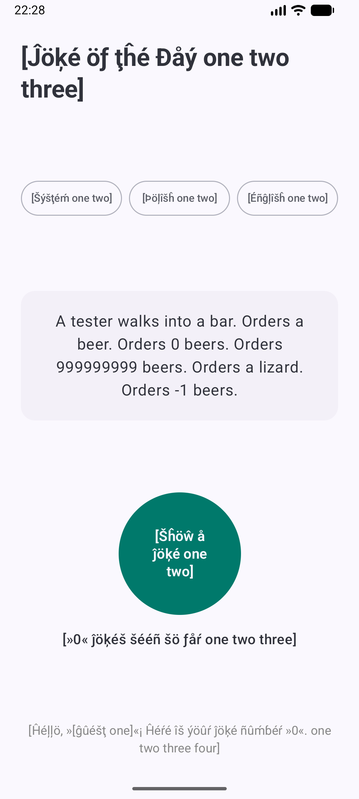

# Laboratorium 3: Tłumaczenie aplikacji (Internationalization & Localization)

## Informacje ogólne
* **Autor:** Karol Budzyń
* **Uczelnia:** Akademia Tarnowska
* **Kierunek:** Informatyka, Inżynieria Systemów Inteligentnych

---

## 1. Cel laboratorium
Głównym celem ćwiczenia było zaprojektowanie i zaimplementowanie mechanizmu internacjonalizacji (i18n) oraz lokalizacji (l10n) w aplikacji „Joke of the Day” napisanej w Jetpack Compose. Zakres prac obejmował:
* Separację warstwy tekstowej od kodu źródłowego przy użyciu dedykowanych zasobów XML (`strings.xml`).
* Obsługę ciągów sformatowanych z argumentami pozycyjnymi (`%1$s`, `%2$d`).
* Wdrożenie dynamicznych tablic ciągów znaków (`<string-array>`).
* Zastosowanie reguł liczby mnogiej (`<plurals>`) zgodnych ze standardem Unicode CLDR dla języka polskiego i angielskiego.
* Implementację mechanizmu przełączania języków wewnątrz aplikacji (*per-app language preferences*) opartego na `LocaleManager`.
* Weryfikację poprawności interfejsu i braku zahardkodowanych napisów za pomocą pseudojęzyka testowego (`en-XA`).

---

## 2. Realizacja poszczególnych zadań

### Zadanie 1: Podstawowa lokalizacja i ciągi sformatowane
Wydzielono teksty interfejsu do pliku zasobów domyślnych `res/values/strings.xml` (język angielski) oraz wariantu lokalizowanego `res/values-pl/strings.xml` (język polski). Wprowadzono ciąg parametryzowany:

```xml
<!-- res/values/strings.xml -->
<string name="greeting">Hello, %1$s! Here is your joke number %2$d.</string>

    <!-- res/values-pl/strings.xml -->
<string name="greeting">Cześć, %1$s! Oto Twój żart numer %2$d.</string>
```

W kodzie Jetpack Compose wstrzykiwanie wartości zrealizowano za pomocą:
```kotlin
stringResource(R.string.greeting, stringResource(R.string.guest), seenCount)
```

### Zadanie 2: Losowanie żartów z tablicy zasobów (`string-array`)
Zastąpiono pojedynczy żart strukturą `<string-array name="jokes">`.
* Pobieranie tablicy w Compose wykonano przez `stringArrayResource(R.array.jokes)`.
* Losowanie żartu zrealizowano z wykorzystaniem generatora pseudolosowego `Random.nextInt(jokes.size)` oraz stanu zachowywanego w `rememberSaveable`.
* **Rozwiązanie problemu technicznego:** Wyeliminowano pojedyncze apostrofy z elementów tablicy XML, zapobiegając błędowi kompilatora zasobów AAPT2 (`NullPointerException` w metodzie `flattenXmlSubTree`).

### Zadanie 3: Obsługa reguł liczby mnogiej (`plurals`)
Zaimplementowano licznik wyświetlonych żartów z uwzględnieniem specyfiki gramatycznej Unicode CLDR:
* **Język polski (`values-pl`):** obsłużono kategorie `one` (1 żart), `few` (2–4, 22–24 żarty) oraz `many` (0, 5–21, 25+ żartów).
* **Język angielski (`values`):** obsłużono kategorie `one` (1 joke) oraz `other` (0, 2+ jokes).

Odczyt w Jetpack Compose:
```kotlin
pluralStringResource(R.plurals.jokes_count, seenCount, seenCount)
```

### Zadanie 4: Przełączanie języka w aplikacji (`LocaleManager`)
Zastosowano natywne API systemowe oparte na klasie `LocaleManager` (dostępnej od Androida 13 / API 33) zamiast biblioteki wstecznej zgodności `AppCompatDelegate`.
* **Uzasadnienie wyboru:** Projekt opiera się w pełni na deklaratywnym UI w Jetpack Compose, wykorzystując `ComponentActivity` i Material 3. Wykorzystanie `AppCompatDelegate` wymusza dziedziczenie po `AppCompatActivity` oraz konfigurację tradycyjnych motywów XML `Theme.AppCompat`. `LocaleManager` jest natywny, lżejszy i bezpośrednio współpracuje z mechanizmem preferencji językowych poszczególnych aplikacji w systemie Android.
* Utworzono plik konfiguracyjny `res/xml/locales_config.xml`:

```xml
<locale-config xmlns:android="[http://schemas.android.com/apk/res/android](http://schemas.android.com/apk/res/android)">
    <locale android:name="en"/>
    <locale android:name="pl"/>
    <locale android:name="en-XA"/>
</locale-config>
```

* Powiązano plik w `AndroidManifest.xml` za pomocą atrybutu `android:localeConfig="@xml/locales_config"`.
* Zaimplementowano funkcję przełączającą język:

```kotlin
fun setAppLocale(context: Context, languageTag: String) {
    if (Build.VERSION.SDK_INT >= Build.VERSION_CODES.TIRAMISU) {
        val localeManager = context.getSystemService(LocaleManager::class.java)
        localeManager?.applicationLocales = if (languageTag.isEmpty()) {
            LocaleList.getEmptyLocaleList()
        } else {
            LocaleList.forLanguageTags(languageTag)
        }
    }
}
```

### Zadanie 5: Testowanie layoutu i gotowości za pomocą pseudojęzyka (`en-XA`)
Włączono generowanie pseudozasobów w konfiguracji debugowania w `app/build.gradle.kts`:

```kotlin
buildTypes {
    debug {
        isPseudoLocalesEnabled = true
    }
}
```

Wyniki testów:
1. **Weryfikacja separacji zasobów:** Wszystkie komponenty tekstowe interfejsu (tytuł, przyciski, licznik `plurals`, stopka powitalna) poprawnie wyświetliły prefiksy i sufiksy `[!!! ... !!!]` oraz diakrytyzowane znaki, co potwierdziło brak zahardkodowanych napisów w kodzie źródłowym.
2. **Wykrycie i eliminacja błędu UI:** Zwiększona długość fraz w pseudojęzyku doprowadziła pierwotnie do zepchnięcia i pionowego ściśnięcia przycisku wyboru języka angielskiego (`en_xa.png`). Problem wyeliminowano poprzez nadanie przyciskom równych wag za pomocą `Modifier.weight(1f)` oraz odstępu `Arrangement.spacedBy(8.dp)`, uzyskując stabilny, elastyczny layout (`en_xa-v2.png`).

---

## 3. Zrzuty ekranu i demonstracja

### Podstawowa lokalizacja i losowanie żartów (Zadania 1 i 2)
| Wersja polska | Wersja angielska |
|:---:|:---:|
|  |  |

---

### Obsługa reguł liczby mnogiej – plurals (Zadanie 3)

#### Język polski (kategorie `one`, `few`, `many`):
| 1 żart (`one`) | 22 żarty (`few`) | 67 żartów (`many`) |
|:---:|:---:|:---:|
|  |  |  |

#### Język angielski (kategorie `one`, `other`):
| 1 joke (`one`) | 33 jokes (`other`) |
|:---:|:---:|
|  |  |

---

### Dynamiczna zmiana języka – LocaleManager (Zadanie 4)
| Przełączanie języków w aplikacji |
|:---:|
|  <br> *(plik źródłowy: `screenshots/change.webm`)* |

---

### Testy pseudojęzykiem en-XA i weryfikacja elastyczności UI (Zadanie 5)
| Wykryty błąd ściśnięcia przycisku (przed poprawką) | Poprawiony układ z wagami (po poprawce) |
|:---:|:---:|
|  |  |

---

## 4. Wnioski
1. Zastosowanie dedykowanych funkcji Compose (`stringResource`, `pluralStringResource`, `stringArrayResource`) umożliwia całkowite oddzielenie logiki aplikacji od warstwy prezentacyjnej i językowej.
2. Obsługa reguł liczby mnogiej za pomocą `<plurals>` jest kluczowa dla języków fleksyjnych (takich jak język polski), w których występują odmienne kategorie gramatyczne (`few`, `many`) niż w języku angielskim (`other`).
3. Pseudojęzyki (`en-XA`) stanowią praktyczne narzędzie QA pozwalające na bezkosztowe wykrycie błędów responsywności interfejsu użytkownika przy dłuższych tekstach oraz natychmiastową weryfikację kompletności ekstrakcji zasobów do plików XML.
